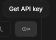
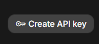
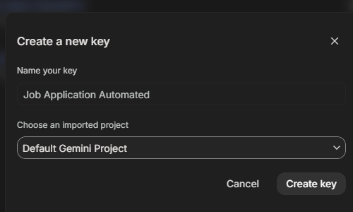
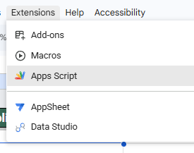
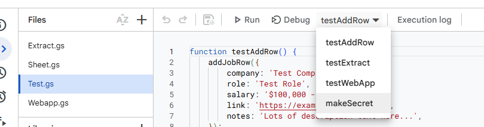
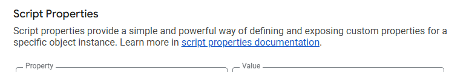
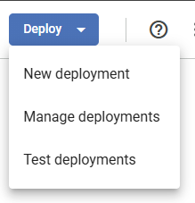
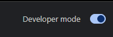
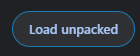

# Job Application Tracker

FEW HOURS TO AUTOMATE A 10 SECOND TASK ONG Damn really made this and got a job offer the next day bruh :crying emoji:

Track your job applications in Google Sheets yuhhh.

When you're on a job posting, click the **Job Tracker** button in Chrome (or press **Alt+Shift+J**). A new row is added to your spreadsheet automatically:

Notes has everything from the page and converted to 1pt font cuz I just wanted it that way. everything else is basic details

Every 100 applications, a new tab is created from your template, named `1-100`, `101-200`, `201-300`, forever or smtng

It uses Google's free Gemini API tier and Google Apps Script. (or atleast setup that way) throw in ur own API if u wanna but im too lazy to host so need to setup for use lol

---

## How it works

it just does idk

- **The Chrome extension** (`extension/` folder) grabs the text of the page you're on and sends it to your web app.
- **The Apps Script** (`apps-script/` folder) lives inside your Google Sheet. It checks the secret, asks Gemini to pull out the company, role and salary, then writes the row.
- **The secret** is a password only your extension knows, so nobody else can add rows to your sheet.

Everyone sets up **their own copy**: their own sheet, their own Gemini key, their own web app. Don't share your web app URL or secret.

^ is what claude said when i told it to write a readme

---

## Setup (about 10–15 minutes, once)

You need a Google account and Google Chrome. (no shit)
I kinda threw in screenshots randomly so idek. had claude generate setup too lol

### 1. Get the spreadsheet

**Copy the shared template sheet** (easiest, because the code comes with it)
1. Open the template link you were given and click **Make a copy**. If it opens the sheet instead, use **File → Make a copy**.
https://docs.google.com/spreadsheets/d/1Nr-5-e0G8Pw9V6XlDsSewkhDBJAYDThpSUAFoigpt_I/edit?usp=sharing
^ this should be a blank copy i hope 

2. Your copy should contain only the **Tracking Template** tab. If it has any rows or numbered tabs (`1-100`, etc.), delete them. 

### 2. Get a free Gemini API key

1. Go to **https://aistudio.google.com** and sign in.
2. Click **Get API key → Create API key**.



3. When asked for a project, choose **Default Gemini Project**. Avoid any project that has billing turned on, or you'll be charged instead of using the free tier.
4. Copy the key.

### 3. Save your key and a secret in the script

1. In your sheet: **Extensions → Apps Script**.

2. Make a secret: open the **Test** file, pick **`makeSecret`** in the function dropdown at the top, and click **▶ Run**. Copy the long random string from the log at the bottom.
   *(The first time you run anything, Google asks for permission. Click **Review permissions → your account → Advanced → Go to … (unsafe) → Allow**. The "unsafe" warning appears because it's your own unverified script, and it only accesses your own sheet.)*

3. Click ⚙️ **Project Settings** on the left, scroll to **Script Properties**, and add two properties:

   | Property | Value |
   |---|---|
   | `GEMINI_API_KEY` | your key from step 2 |
   | `SHARED_SECRET` | the random string from `makeSecret` |

   If you copied a friend's sheet and these already exist, **replace them with your own**.
   

### 4. Deploy the web app

1. In the Apps Script editor, top right: **Deploy → New deployment**.
2. Click the ⚙️ next to *Select type* → **Web app**.
3. Set:
   - **Description:** `v1`
   - **Execute as:** **Me**
   - **Who has access:** **Anyone** (your secret is what keeps others out)
4. Click **Deploy** and copy the **Web app URL**. It ends in `/exec`.
   Ignore the *Library* URL; it isn't used.
   

### 6. Install the Chrome extension

1. Download this project's `extension` folder (for example, from GitHub: **Code → Download ZIP**, then unzip).
2. In the `extension` folder, copy **`config.example.js`** and rename the copy to **`config.js`**.
3. Open `config.js` in any text editor (Notepad works) and fill in:
   ```js
   const WEB_APP_URL = 'your Web app URL from step 5';
   const SHARED_SECRET = 'your secret from step 3';
   ```
4. In Chrome, go to **`chrome://extensions`**, turn on **Developer mode** (top right), click **Load unpacked**, and select the `extension` folder.


5. Click the 🧩 puzzle icon in the toolbar and **pin** Job Tracker.

Done! yayyyyy

---

## Everyday use

1. Open a job posting and apply.
2. Click the **Job Tracker** button (or press **Alt+Shift+J**).
3. **Keep the popup open** until it says **✓ Added: Company — Role (tab 1-100)**. Clicking away can cut the save off.

Then update **Application Status** by hand as things happen (Interviewing, Rejected, …). The script only ever adds new rows and never changes old ones.

If the AI gets the company, role or salary wrong, just fix the cell. The full posting is always saved in **Notes**.

---

## Troubleshooting

Thank god for ai cuz i hate writing readme's so much

| What you see | What it means / what to do |
|---|---|
| `✗ Wrong secret` | `SHARED_SECRET` in `config.js` doesn't match the one in Script Properties. Fix it, then click ↻ reload on the extension in `chrome://extensions`. |
| `✗ Gemini API error 503` | Google's servers are busy. The script already retries 4 times, so wait a minute and click again. |
| `✗ Gemini API error 429` | You hit the free tier's rate limit. Wait a minute and try again. |
| `✗ Gemini API error 400/403` | Usually a wrong or missing `GEMINI_API_KEY` in Script Properties. |
| `✗ Missing GEMINI_API_KEY` | Add it in Apps Script → Project Settings → Script Properties. |
| `✗ Cannot access contents of the page` / error on a Chrome page | Extensions can't read Chrome's own pages (`chrome://…`, the New Tab page). Use it on the job posting itself. |
| `✗ Failed to fetch` / `Unexpected token <` | The `WEB_APP_URL` in `config.js` is wrong, or the deployment's access isn't set to **Anyone**. |
| "I changed the code but nothing changed" | See **Updating the code** below. The web app runs a frozen copy until you deploy a new version. |
| A row landed far down the sheet | Something is typed in column A of the template below the header. Clear it. |
| Some info is missing from Notes | Some job sites load the description inside an embedded frame, which the extension can't read. Paste it in by hand. |

---

## Updating the code

this is just personal reference atp

The web app URL runs a **frozen copy** of the code from when you deployed it. After changing any Apps Script code:

1. **Deploy → Manage deployments**
2. Select your deployment → ✏️ **Edit**
3. **Version: New version** → **Deploy**

The URL stays the same, so there's no need to touch the extension.
Do **not** use *New deployment* for updates; that creates a second, different URL.

After changing any **extension** file, click ↻ **reload** on the extension's card in `chrome://extensions`.

---

## Customizing

gemini lite works fine for this tbh

| Want to change… | Where |
|---|---|
| Rows per tab (default 100) | `ROW_PER_TAB` in `apps-script/Sheet.js` |
| The default status / rejection reason | `DEFAULT_STATUS` and `DEFAULT_REJECTION` in `apps-script/Sheet.js`. They must exactly match an option in your dropdowns |
| The Gemini model | `MODEL` in `apps-script/Extract.js` (`gemini-flash-latest` or `gemini-flash-lite-latest`) |
| What the AI extracts | `EXTRACT_PROMPT` and the schema in `apps-script/Extract.js` |
| The keyboard shortcut | `chrome://extensions/shortcuts` |

---

## For developers: editing locally with clasp

this is just generally syncing google app to your vsc an shi

You can edit the Apps Script code in VS Code instead of the browser using [clasp](https://github.com/google/clasp):

```bash
npm install -g @google/clasp
clasp login
# turn on "Google Apps Script API" at https://script.google.com/home/usersettings
clasp clone <SCRIPT_ID> --rootDir apps-script   # Script ID: Apps Script → Project Settings
```

Workflow:
1. Edit files in `apps-script/`.
2. `clasp push` to upload. This overwrites the online code, so run `clasp pull` first if you edited in the browser.
3. Refresh the browser editor and run test functions with ▶ Run.
4. Deploy a new version (see **Updating the code**) for the extension to pick up the changes.
